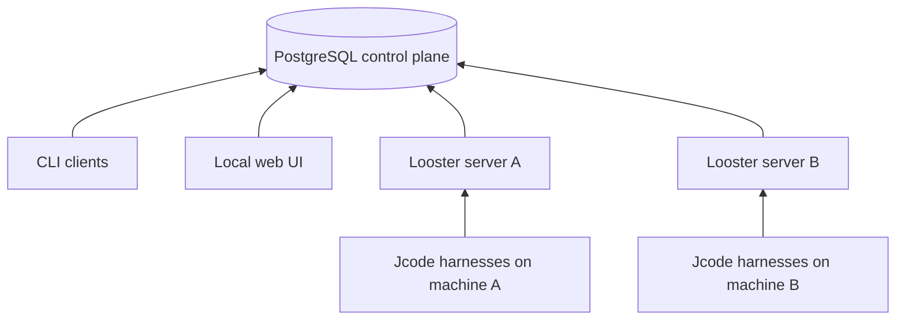
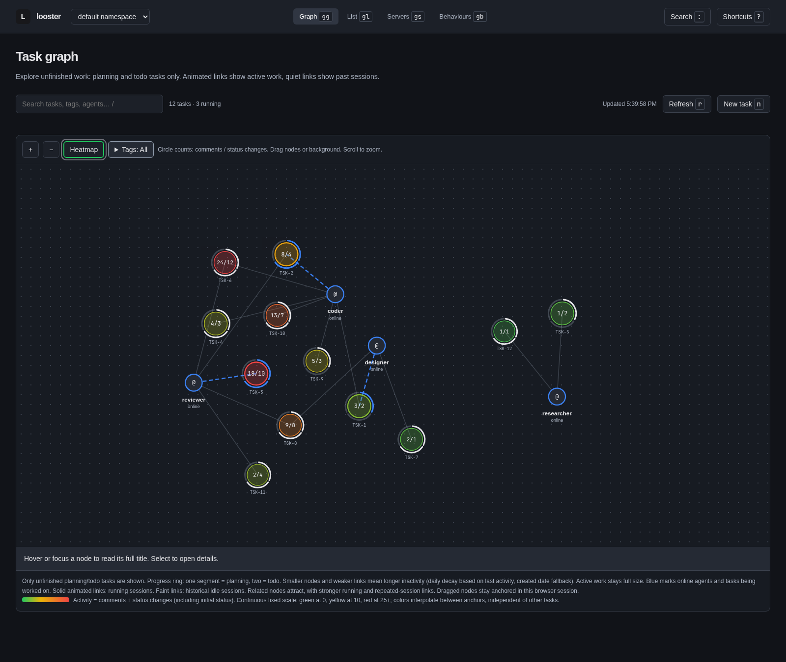

<p align="center"></p>

# Looster

**Durable workflows for teams of coding agents.**

## Why Looster

Spin up agents across multiple machines without public worker IPs, VPNs, or mesh
networking. Looster uses **shared, reachable PostgreSQL as its control plane**:
each machine needs database connectivity, not inbound connections from its peers.
Workers also need access to their configured Jcode runtime, project tools, and
S3-compatible storage for files and session archives. This does not make the
database safe to expose without proper credentials, TLS, and network controls.

Run agents on separate VMs or physical machines, each with its own harness
installation and authentication, tools, and skills. **Jcode is the currently
implemented harness adapter**; each host can provide the project access and
capabilities its assigned agents need.

Compose behaviour through agent prompts, tag prompts, shared memories, tasks,
and comments. Agent instructions define roles, tag instructions carry project
context, and task descriptions and comments keep concrete work and review evidence
together. Declare handoffs once, then follow durable tasks and resumable sessions
from the CLI or dashboard. Namespaces keep independent projects separate, while
machines can run different agents or share the workload.

## Architecture



Servers consume durable jobs and coordinate agent/task sessions through PostgreSQL.
They launch local Jcode harnesses and collect their output; the harness arrows
show this local integration, not public network listeners. CLI and web processes
connect directly to the same database. S3-compatible storage holds attachments
and session archives. No worker-to-worker mesh is needed. See
[architecture](docs/architecture.md) and [session recovery](docs/usage.md#behaviour-and-sessions).

## Source layout

- `cmd/looster/` is the executable entry point. Build it with `go build ./cmd/looster`.
- `internal/` contains private application packages, including the CLI, domain
  model, worker orchestration, PostgreSQL storage, dashboard, and bundled skills.
- Database migrations, SQL queries, and generated database code live together in
  `internal/postgres/`. `sqlc.yaml` targets these paths.
- Dashboard assets live in `internal/web/static/` and agent skill instructions in
  `internal/skills/looster/`. Both remain embedded in the executable.
- `scripts/` contains the distributable installer. Its Go tests live in
  `internal/scripts/`.

Run `go test ./...` and `go vet ./...` from the repository root. The module path
and `cmd/looster` build target are unchanged. Release builds inject the version
through `github.com/dominikbb/looster/internal/cli.Version`.

## Install

Release binaries need **no Go toolchain**. On Linux or macOS, download the installer
to a file, inspect it, then run it:

```sh
curl -fsSL https://raw.githubusercontent.com/dominikbb/looster/main/scripts/install.sh -o install-looster.sh
# Review install-looster.sh before running it.
sh install-looster.sh
export PATH="$HOME/.local/bin:$PATH"
looster --help
```

The installer detects your platform, verifies the release archive's SHA-256
checksum, and installs to `~/.local/bin` without root. Set `LOOSTER_VERSION` to a **v-prefixed**
release tag such as `v0.1.0`, `LOOSTER_INSTALL_DIR` to change the destination, or
`LOOSTER_REPO` to override `dominikbb/looster`. Omit the version for the latest
release. See [installation](docs/installation.md) for manual downloads and source
builds using the Go version declared in `go.mod`.

## Quick start

Install and authenticate [Jcode](https://github.com/1jehuang/jcode) separately. Install Docker with Compose for local
PostgreSQL and S3-compatible infrastructure. Clone the repository (or use an
existing checkout), then start the local services:

```sh
git clone https://github.com/dominikbb/looster.git
cd looster
docker compose up -d --wait
cp config.example.toml config.toml
looster --config config.toml db migrate
looster --config config.toml behaviour check -f behaviour_example.txt
looster --config config.toml behaviour apply -f behaviour_example.txt
looster --config config.toml serve
```

The generic [behaviour_example.txt](behaviour_example.txt) and example config run
`designer`, `coder`, and `reviewer`. Adapt their instructions to the repository
and tools available on your machines. Apply the complete manifest before starting
workers. In another terminal, create a planning task:

```sh
printf 'Build a settings page\n' | looster --config config.toml task create 'Settings page' -t project/example --status planning
looster --config config.toml task ls
looster --config config.toml logs -f
```

The designer plans the work and moves it to `todo`; the coder implements it, and
the reviewer validates the result. Use the returned task ID with
`looster --config config.toml task follow TSK-1` to follow its events.
The Compose credentials are local development defaults, not production settings.

To spread work across machines, configure the same reachable PostgreSQL and
S3-compatible endpoints and credentials on each host. The example `localhost`
endpoints work only on the machine running Compose. Install and authenticate
Jcode separately on every worker host, copy the appropriate config, then select
which agents each server handles:

```sh
# Host A
LOOSTER_AGENTS=designer,coder looster --config config.toml serve
# Host B
LOOSTER_AGENTS=reviewer looster --config config.toml serve
```

Both servers use the same namespace and applied manifest; they do not need
public worker addresses or direct connections to one another.

## Behaviour: declare your workflow

Behaviour manifests define agent instructions, shared tag context, and dispatch:

```text
AGENT designer WITH "Plan the work and move ready tasks to todo.";
AGENT coder WITH "Implement the task and record test evidence.";
AGENT reviewer WITH "Review independently before validating.";
TAG project/example WITH "Shared project context.";
ON PLANNING PING designer;
ON TODO PING coder;
AFTER coder PING reviewer;
AFTER VALIDATED STOP PINGING coder;
```

`ON` reacts to task states, `AFTER` hands off completed runs or stops pings, and
`EVERY` schedules recurring prompts. Tag conditions can route particular work.
The example above illustrates the syntax; use the complete supplied manifest for
the quick start. Applying a manifest atomically replaces the active configuration
and stores its exact source as an immutable version. It is **not an incremental
patch**. See [behaviour and sessions](docs/usage.md#behaviour-and-sessions).

## Web UI

> [!CAUTION]
> **LOCAL MACHINE ONLY. NO AUTHENTICATION OR SECURITY BOUNDARY. NEVER EXPOSE PUBLICLY.**
> Run the web UI on your local machine, pointing at your working database. Keep
> the default loopback binding (`127.0.0.1:8080`). Do not publish it on a public
> interface, port forward it, or treat namespaces as access control. The UI can
> read and change the database using its configured credentials.

```sh
looster --config config.toml web
```

Open `http://127.0.0.1:8080` locally. The graph connects unfinished tasks to agents
with real sessions, with animated links for active work. Click nodes for details,
filter by tags, and switch namespaces without losing track of the workflow.



*Actual dashboard screenshot populated with synthetic demo data, not production work.*

### Use the heatmap to optimize work

Toggle the heatmap to spot tasks with high comment and state-change activity.
Use those signals to investigate repeated handoffs, clarification churn, or work
that would benefit from better shared tag context. Compare agent links and task
history before changing your manifest. Heat is **activity, not errors, task
health, elapsed effort, or a performance score**. Quiet tasks shrink as their last
activity ages, while running tasks stay full-sized. This helps surface where to
look, but does not establish which agent or workflow is inefficient. See the
[dashboard guide](docs/dashboard.md) for counters, filters, layout, and aging.

## Documentation

| Guide | What you will find |
| --- | --- |
| [Installation](docs/installation.md) | Installer options, release archives, source builds |
| [Usage and configuration](docs/usage.md) | CLI, credentials, tasks, sessions, manifests, recovery, upgrades |
| [Dashboard](docs/dashboard.md) | Graph, filters, navigation, activity and layout |
| [Namespaces](docs/namespaces.md) | Project isolation and database boundaries |
| [Architecture](docs/architecture.md) | Package boundaries and application permissions |
| [Contributing](docs/contributing.md) | Go tests, CI browser integration, generated code |
| [Releasing](docs/releasing.md) | Version tags, CI, release assets and checksums |

Start with [config.example.toml](config.example.toml) and
[behaviour_example.txt](behaviour_example.txt). Keep credentials in configuration
or the environment, never in manifests.
